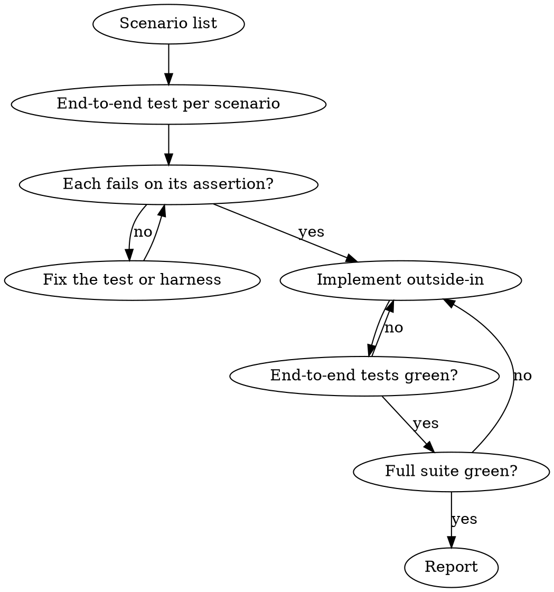

# Acceptance First

## Overview

Every behavior change starts as a list of scenarios. Every scenario becomes an end-to-end acceptance test that drives the whole running system the way a real user or caller does: through the UI for user-facing flows, over HTTP for APIs, through the real entrypoint for a CLI, with a real database and your real code underneath. Production code is written to turn those tests green, and the work is done only when they and the whole suite are green.

**Core principle:** end-to-end tests define "done". Only a passing end-to-end test can say a scenario is implemented. Unit tests are an occasional aid for dense logic; they never stand in for a scenario's end-to-end test, and passing unit tests never mean done.

Use real collaborators everywhere. Mocks are a last resort, not a default. Violating the letter of this process is violating its spirit.

## Scope

This is for the app's functionality: features, bug fixes and behavior changes a user or caller can see, in the applications and the libraries, APIs and jobs they are built from. Test what the app does, not how it is put together.

It doesn't apply to, and calls for no new tests of:

- deployment scripts, CI and CD configuration, and infrastructure configuration;
- scripts and developer tools: one-off and repository scripts, editor and agent setup, build and test tooling;
- framework setup and plumbing: how the app boots, which environment it runs in, which servers and processes run it, configuration, logging, dependency upgrades;
- refactors and renames that keep behavior the same: the existing tests are the safety net.

Change those without writing tests for them, and check them by running them and the existing suite. If a coverage gate then asks for tests of code such a change touched, tell the user instead of writing tests around it.

## The Loop



### 1. Scenario list

Before any code, write the list in the plan (plan mode) or in your response, in this shape:

```
Scenarios: <feature>
1. [user]  <situation> → <observable outcome>
2. [added] <situation> → <observable outcome>
3. [added] <situation> → <observable outcome>  [below-e2e: <reason>]
Questions: <added scenarios that need a decision>
```

- Copy every user-supplied scenario verbatim, tagged `[user]`. Never drop, merge, or reword them.
- Extend with `[added]` scenarios from these categories: empty/missing input · boundaries (0, 1, max, max+1) · invalid or malformed input · unauthenticated / unauthorized · not found / already deleted · duplicates, retries, idempotency · dependency failure (timeout, 5xx, bad payload) · state transitions and ordering · concurrency · time zones, DST, locale, encoding · large volume, pagination.
- Add edge cases of the feature's own behavior, not of the setup around it: how the app boots or is configured, and which servers run it, aren't scenarios.
- An `[added]` scenario that introduces behavior the user did not ask for (new UX, a policy choice, a new feature) goes under **Questions**; ask before implementing it. Edge cases of requested behavior get implemented without asking.
- Bug fix: scenario 1 is the reported bug, reproduced end to end.
- Every scenario is tested end to end. If one can't be (see step 2), tag it `[below-e2e: <reason>]` so the user sees the gap before you build.

### 2. Pick the boundary: end-to-end by default

Drive the system the way its real caller does, at the highest level that runs reliably inside the test suite. Start at end-to-end. Use the fallback column only when end-to-end can't run in the suite, and tag those scenarios `[below-e2e]`.

| System | End-to-end (default) | Fallback | Typical tools |
|---|---|---|---|
| Web app: user-facing flow | The rendered UI driven like a user (browser driver when JS is involved), full stack, real database | HTTP request → response + persisted state | RSpec system specs, Playwright, Django test client |
| Web app or API: endpoint with no UI (JSON, status, redirect, webhook) | HTTP request to the app with a real database; assert the response and persisted state | — | RSpec request specs, Rack::Test, supertest, FastAPI TestClient, `httptest` |
| Frontend SPA | Real browser against the real backend and database | Rendered UI with the backend faked at the network layer | Playwright, Testing Library (query by role/label), msw |
| CLI | The real entrypoint with args/stdin/env | — | exit code, stdout/stderr, files written to a temp dir |
| Library | Public API only, as a consumer imports it | — | the package's test runner |
| Job / worker / consumer | Trigger through the real entry point that enqueues it (request, CLI, event), drain, assert the persisted outcome | Enqueue or publish directly, drain, assert | `perform_enqueued_jobs`, in-memory broker adapter |
| Mobile app | UI test against the real app layers | View model with the real layers below | XCUITest, Compose UI tests |

Use the project's existing end-to-end harness. If there is none, propose the smallest one that drives the real UI or entrypoint, and ask before adding a browser-automation dependency. Until it exists, use the fallback and tag those scenarios `[below-e2e: no harness]`.

### 3. Red first

Write the end-to-end tests for all scenarios before production code. Name each test after its scenario. Run them and read the failures: each must fail on its assertion because the behavior is missing, not on a syntax error, missing factory, or crashed harness.

### 4. Implement outside-in

Start at the entry point and work inward, running the end-to-end tests to find the next missing piece. Add a unit test only when you reach logic with so many branches that covering each one end to end would be impractical (parsing, pricing, validation rules, state machines). Write it first, against real objects where you can. Those unit tests cover the combinatorics; they don't duplicate a scenario, and they don't count toward done.

### 5. Loop until green

After each change, run the end-to-end tests; fix the implementation, not the test. When they pass, run the full suite. Stop only when both are green.

If you cannot get to green (a service you can't start, pre-existing failures, two scenarios that contradict each other), stop and tell the user with the failing output. Say which scenarios pass and which don't.

### 6. Report

End with a table: scenario → end-to-end test (`file:line`) → pass/fail. Name every `[below-e2e]` scenario and its reason. Then list the commands you ran and paste the tail of the passing output.

## Mocks: Last Resort

Default to no mocks. Before faking anything, go down this list and stop at the first option that works:

1. The real thing: your code, the framework, the database, the filesystem (temp dir), the in-process queue adapter.
2. A real test instance: the test database, a local service container, the vendor's sandbox.
3. A fake: an in-memory implementation or the framework's test adapter (mailer, queue, storage).
4. A stub at the wire for third-party HTTP: WebMock/VCR, msw, respx, nock, an `httptest` server.
5. A mock object: unit tests only, for a boundary collaborator, when 1–4 don't work.

| In end-to-end tests | Use real | Fake at the process edge |
|---|---|---|
| Your code, framework, database, in-process queue adapter, filesystem (temp dir) | ✓ | |
| Third-party HTTP APIs | | WebMock/VCR, msw, respx, nock, `httptest` server |
| Clock and randomness | | `travel_to`, freezegun, fake timers, seeded RNG |
| Email, SMS, payments, push | | framework test adapter or the vendor's sandbox fake |

- Never mock the unit under test or your own classes in an end-to-end test.
- Assert on outcomes (response, rendered page, persisted state, output), not on which methods were called.
- Unit tests may mock a boundary collaborator, sparingly. One mock in a test is normal; mocking every collaborator is not. A unit test that needs more than two mocks is testing at the wrong level: cover that behavior end to end instead.

## Test Integrity

A green suite reached by changing the tests is not green.

- Never delete, skip (`skip`, `xit`, `pending`, `.only`, `@pytest.mark.skip`, `t.Skip`), or loosen the assertion of a failing test to make it pass.
- Never special-case test inputs in production code.
- If a test is genuinely wrong, because it contradicts a scenario, fix it and name the change and the reason in your report.

## Done: the suite passes in CI

The project's full suite (`bin/test` at the repo root, where it exists) decides: the work is done when it passes in CI on the pull request. While you work, run the tests you changed; CI runs the whole suite.

- If the project has no `bin/test`, propose one: an executable script that sets up what the suite needs and runs it, exiting non-zero on failure. Run the full suite, or only the end-to-end layer if the full suite takes more than ~10 minutes. Create it when the user agrees, and commit it so worktrees get it too.
- While iterating, run the failing tests directly.
- In a project without `bin/test`, the user can run `/goal all end-to-end tests pass` for the session instead.

## Rationalizations

| Excuse | Reality |
|---|---|
| "A unit test is faster to write" | It proves the unit, not the feature. Every scenario gets an end-to-end test. |
| "The unit tests pass, so it works" | Only an end-to-end test shows the pieces work together. Not done until it passes. |
| "Too small for an end-to-end test" | Small features break at the seams too. A system or request spec is about ten lines. |
| "A request spec is enough; the browser is slow" | For a user-facing flow the UI is the boundary. Drop below it only when it can't run, and tag the scenario. |
| "I'll add the end-to-end test at the end" | Then it's written to match the code, not the scenario. Red first. |
| "Mocking it is simpler / keeps the test fast" | Then the test passes while the integration is broken. Use the real thing or an in-memory fake. |
| "There's no end-to-end harness" | Propose the smallest one, or ask. Not a reason to skip. |
| "The test is flaky, I'll skip it" | Fix the flakiness (wait on a condition, not a sleep). Skipping is deleting. |
| "The failing test is wrong" | Maybe. Say which scenario it contradicts, then fix it openly. |
| "The user's scenarios are enough" | They are the floor. Add the edge cases. |
| "This boot, config or script change could break, so I'll spec it" | Specs are for the app's behavior. Check setup, plumbing and scripts by running them; the existing suite catches what they break. |

## Red Flags: Stop and Go Back to Step 1

- Production code exists and no end-to-end test has failed yet
- A scenario with no end-to-end test mapped to it and no `[below-e2e]` reason
- Calling something done when only unit tests pass
- A spec that starts servers, boots the app in another process, or checks configuration rather than a feature
- `allow_any_instance_of`, `jest.mock('./own-module')`, or `patch('myapp.…')` inside an end-to-end test
- A unit test with more mocks than assertions, or a test file where most tests mock
- Editing an assertion right after it failed
- Saying "done" without full-suite output
